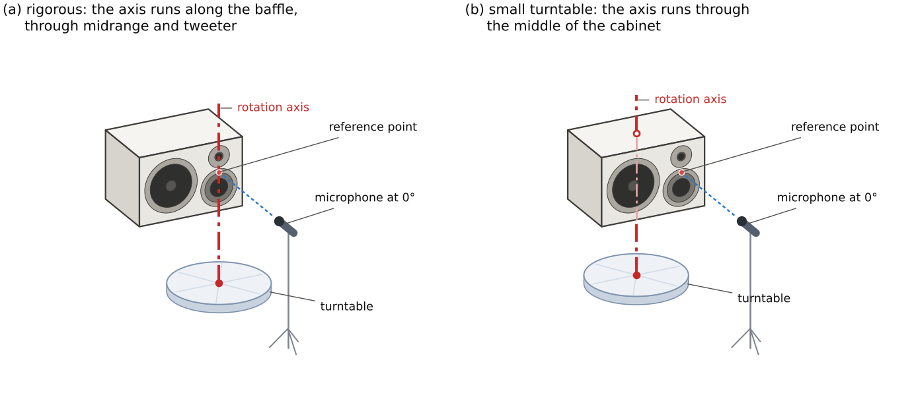

# Polar measurements on a small turntable: how well can the rotation center be corrected?

A free-field simulation study for small loudspeaker manufacturers and DIY builders whose
turntable is too small to rotate the cabinet about its baffle.



A polar measurement should turn the loudspeaker about a reference point on its baffle (a). On a
small turntable the cabinet is centered instead (b): the rotation axis lies 145 mm behind the
baffle, and for this horizontal monitor also 120 mm to the side of the reference axis, so the
microphone is moved sideways to face the reference point at 0°. Off axis, the microphone is then
farther away and in another direction than intended.

This repository simulates both setups and tests a purely geometric correction: each driver is
treated as a point source with its own directivity; every measurement is moved to the intended
distance (delay and gain, distances in 3D) and the powers of the two measurements that bracket the
intended direction are interpolated, with the phase of their complex interpolation. The same model can
rebuild the data as seen from a larger circle than the one measured on. A two-way variant in the same
cabinet is also solved by the boundary-element method (BEM), to check what the cabinet-diffraction
model and the point-like drivers miss. The report, with every formula used, is
[`paper/main.pdf`](paper/main.pdf).

## The simulated loudspeaker

- Horizontal three-way monitor, 440 × 290 × 290 mm closed box (24 L): woofer on the left, 3-inch
  dome midrange and 1.1-inch dome tweeter stacked on the right.
- Drivers: Dayton Audio SIG225-4 (flat piston, closed box), HiVi DM-7600 (equivalent spherical cap
  fitted to its 30° datasheet curve), SICA LP 90.28/N92 (spherical cap). On-axis responses follow
  the datasheet curves, extracted from the PDF vector graphics, with minimum phase.
- Cabinet diffraction: Distributed Edge Dipole (DED) model, evaluated at the actual microphone
  position.
- Free field only (no room): the study isolates the correction.
- Horizontal orbit from −180° to 180° in 10° steps, microphone at 1 m and 2 m, at the height
  midway between midrange and tweeter.

## Main results

| | 1 m | 2 m |
|---|---|---|
| Summed loudspeaker, RMS level error, uncorrected | 2.45 dB | 1.24 dB |
| Summed loudspeaker, RMS level error, corrected | 0.24 dB | 0.22 dB |
| … corrected, 5° orbit | 0.19 dB | 0.09 dB |
| … lateral offset omitted | 0.92 dB | 0.56 dB |
| … lateral offset with the wrong sign | 1.66 dB | 1.01 dB |
| Largest PIR deviation, uncorrected | 1.02 dB | 0.48 dB |
| Largest PIR deviation, corrected | 0.12 dB | 0.08 dB |
| Largest PIR deviation, lateral offset omitted | 0.19 dB | 0.08 dB |

(RMS over the points within each driver's band and no more than 20 dB below the on-axis response;
PIR from the horizontal orbit, 100 Hz–20 kHz.)

- **Direct sound**: the correction is nearly exact (0.1 dB RMS on the summed loudspeaker). Most of it
  is the price of interpolating powers on a well-sampled main lobe; interpolating the complex responses
  would leave 0.03 dB. The drivers' heights relative to the microphone (±65 mm) do not matter.
- **Diffraction** is what remains: the edge waves do not come from the driver. The residual sits
  behind the cabinet at mid and high frequencies; part of it is angular undersampling of the rear
  interference pattern (a 5° orbit removes most of it at 2 m), part is the finite-distance
  geometry of the edge waves (it shrinks with distance).
- **Spatial averages** (listening window, early reflections, sound power, PIR, DI) of the corrected
  data are within about 0.1 dB of the rigorous ones.
- **The lateral offset matters for the individual curves**: when the microphone is moved sideways to
  face the reference point, the correction needs that offset, with its sign (positive toward the side
  the microphone faces at +90°). Omitted or with the wrong sign, it places the measurements up to 11° or
  21° away from where they were taken at 1 m, and the curves keep four to seven times the residual. The
  spatial averages hardly notice, because the powers are interpolated; with the complex responses
  interpolated, the same mistakes made the PIR worse than no correction (3.8 and 3.3 dB at 1 m). Errors
  of ±10 mm on the depth or lateral offset cost less than 0.1 dB on the PIR.
- **Rebuilt at 2 m from 1 m measurements**, the woofer beside the reference axis is seen from the right
  angles (its error falls from 0.74 to 0.16 dB RMS), but the PIR stays 0.18 dB off against 0.08 dB
  measured at 2 m: the cabinet's diffraction heard from 1 m is not the one heard from 2 m.

## The boundary-element check

The edge-diffraction model and the point-like drivers are the weak points of the study, and they
matter most where the correction's residual is: behind the cabinet. A two-way variant in the same
cabinet (the SIG225-4 and the SICA tweeter, both at mid-height, so that the plane of the horizontal
orbit is a plane of symmetry) was solved by a Galerkin Burton–Miller BEM with extended rigid
radiators (a recessed cone, a dome) and the whole cabinet, 20 Hz to 16 kHz at 1/48 octave (464
frequencies, up to 40 937 unknowns on the half model, dense LU in double precision, 3.8 h on a Mac
mini M4 Pro), at 1728 microphone positions: the horizontal and vertical orbits of both setups, at
1, 2 and 4 m, every 2.5° (the vertical one measured with the cabinet on its side). The solver,
Huygens, is not public; its pressures are in [`data/bem/`](data/bem/).

| Two-way, BEM: summed loudspeaker, RMS level error | 1 m | 2 m | 4 m |
|---|---|---|---|
| uncorrected | 2.56 dB | 1.79 dB | 1.20 dB |
| corrected, 10° steps | 0.62 dB | 0.60 dB | 0.58 dB |
| … 10° steps, complex responses interpolated | 1.21 dB | 1.05 dB | 1.02 dB |
| … 5° steps | 0.41 dB | 0.28 dB | 0.27 dB |
| … 2.5° steps | 0.38 dB | 0.14 dB | 0.09 dB |

| Two-way, BEM: largest PIR deviation | 1 m | 2 m | 4 m |
|---|---|---|---|
| horizontal orbit, uncorrected | 1.24 dB | 0.65 dB | 0.33 dB |
| … corrected, 10° steps | 0.55 dB | 0.32 dB | 0.16 dB |
| … corrected, 2.5° steps | 0.15 dB | 0.10 dB | 0.07 dB |
| both orbits, uncorrected | 0.95 dB | 0.47 dB | 0.25 dB |
| both orbits, corrected, 10° steps | 0.34 dB | 0.17 dB | 0.09 dB |
| Same edge model (DED) for this two-way: horizontal, corrected, 10° steps | 0.08 dB | 0.06 dB | 0.04 dB |

(1/24-octave smoothing; 100 Hz–16 kHz.)

- **Below about 3 kHz the BEM confirms the DED results**: the corrected spatial averages are within
  about 0.1 dB of the rigorous ones, and the lateral offset is just as critical.
- **Above, there is more diffraction than the edge model predicts.** The rigid dome radiates much
  wider than its aperture model (−6 dB at 95° instead of 75° at 6.35 kHz), so more sound reaches the
  edges; the far edge of the baffle, 330 mm from the tweeter, adds interference ripples with a 10°
  period at 6 kHz in front, on the woofer's side, and the rear patterns are finer.
- **The residual is mostly the angular step.** With 10° steps about 0.6 dB RMS remains on the summed
  loudspeaker at every distance; 2.5° steps bring it to 0.1–0.15 dB at 2 and 4 m. At 1 m about 0.4 dB
  remains whatever the step: the edges' finite-distance geometry. Even the rigorous 10° data alias the
  far edge's ripple: their listening window differs by up to 0.6–0.7 dB at 7–8 kHz from a dense average.
- **Interpolate powers.** Where the step undersamples the pattern, interpolating complex responses
  cancels in part (artificial notches); interpolating the re-propagated powers, keeping the complex
  interpolation's phase, halves the residual at 10°.
- **The vertical orbit**, measured with the cabinet on its side (depth only, the woofer 205 mm beside the
  plane), corrects the same way: 1.86 dB RMS uncorrected, 0.38 dB with 10° steps, 0.26 dB with 5° at 1 m.
- **At another distance**: the 1 m data rebuilt as seen from 2 m keep 0.65 dB RMS on the sum and 0.35 dB
  on the PIR whatever the step, where 2 m measurements with 2.5° steps reach 0.14 and 0.06 dB. The
  rebuild cannot move the cabinet's near field: the low-frequency acoustic center about 130 mm ahead of
  the baffle (as described by Vanderkooy; it does not disturb the correction at the measurement distance)
  and the diffraction pattern, both different at 1 and 2 m.

## Reproduce

Python 3.10+:

```sh
pip install -r requirements.txt
make test      # unit tests
make study     # all simulated measurements (about 1.5 minutes, writes results/study.npz)
make bem       # the two-way from the BEM data, its DED model and point sources (about 1 minute, results/bem.npz)
make figures   # figures and tables in paper/
make paper     # paper/main.pdf (needs a LaTeX distribution with latexmk)
```

## Layout

| path | content |
|---|---|
| `rotcenter/geometry.py` | cabinet, driver layout, turntable kinematics, correction parameters |
| `rotcenter/directivity.py` | piston, spherical-cap dome and recessed-cone directivities |
| `rotcenter/drivers.py` | driver models from the datasheets, closed box |
| `rotcenter/diffraction.py` | Distributed Edge Dipole cabinet diffraction |
| `rotcenter/simulate.py` | pressure of each driver at any microphone position |
| `rotcenter/correction.py` | the rotation-center correction in 3D, at any distance (impulse responses or spectra) |
| `rotcenter/cta2034.py` | CTA-2034-A curves from the horizontal orbit, or from both |
| `rotcenter/system.py` | illustrative three-way crossover |
| `rotcenter/twoway.py` | the two-way variant: BEM data, drivers' volume velocities, crossover |
| `scripts/` | study, BEM check, figures, schematics |
| `data/datasheets/` | datasheet curves (see the notes there) |
| `data/bem/` | BEM pressures of the two-way (`two_way.npz`, single precision) at the 1728 microphone positions of `points.json` |
| `paper/` | LaTeX report, figures, generated tables |

## License

Code under the MIT license. The datasheet curves belong to their manufacturers and are used for
technical analysis only.
