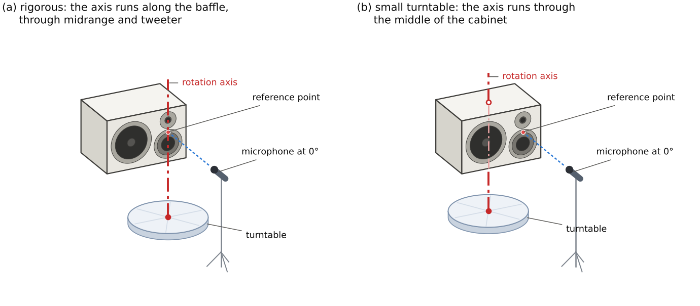

# Polar measurements on a small turntable: how well can the rotation center be corrected?

A free-field simulation study for small loudspeaker manufacturers and DIY builders whose
turntable is too small to rotate the cabinet about its baffle.



A polar measurement should turn the loudspeaker about a reference point on its baffle (a). On a
small turntable the cabinet is centered instead (b): the rotation axis lies 145 mm behind the
baffle, and for this horizontal monitor also 120 mm to the side of the reference axis, so the
microphone is moved sideways to face the reference point at 0°. Off axis, the microphone is then
farther away and in another direction than intended.

This repository simulates both setups and tests a purely geometric correction: each driver is
treated as a point source with its own directivity; every measurement is moved to the intended
distance (delay and gain) and interpolated to the intended direction. The report, with every
formula used, is [`paper/main.pdf`](paper/main.pdf).

## The simulated loudspeaker

- Horizontal three-way monitor, 440 × 290 × 290 mm closed box (24 L): woofer on the left, 3-inch
  dome midrange and 1.1-inch dome tweeter stacked on the right.
- Drivers: Dayton Audio SIG225-4 (flat piston, closed box), HiVi DM-7600 (equivalent spherical cap
  fitted to its 30° datasheet curve), SICA LP 90.28/N92 (spherical cap). On-axis responses follow
  the datasheet curves, extracted from the PDF vector graphics, with minimum phase.
- Cabinet diffraction: Distributed Edge Dipole (DED) model, evaluated at the actual microphone
  position.
- Free field only (no room): the study isolates the correction.
- Horizontal orbit from −180° to 180° in 10° steps, microphone at 1 m and 2 m, at the height
  midway between midrange and tweeter.

## Main results

| | 1 m | 2 m |
|---|---|---|
| Summed loudspeaker, RMS level error, uncorrected | 2.45 dB | 1.24 dB |
| Summed loudspeaker, RMS level error, corrected | 0.24 dB | 0.23 dB |
| … corrected, 5° orbit | 0.19 dB | 0.09 dB |
| Largest PIR deviation, uncorrected | 1.02 dB | 0.48 dB |
| Largest PIR deviation, corrected | 0.14 dB | 0.07 dB |
| Largest PIR deviation, lateral offset omitted | 3.82 dB | 2.42 dB |
| Largest PIR deviation, lateral offset with the wrong sign | 3.26 dB | 2.13 dB |

(RMS over the points within each driver's band and no more than 20 dB below the on-axis response;
PIR from the horizontal orbit, 100 Hz–20 kHz.)

- **Direct sound**: the correction is essentially exact (0.02–0.08 dB RMS). The vertical offsets
  between drivers and microphone, ignored by the planar model, do not matter.
- **Diffraction** is what remains: the edge waves do not come from the driver. The residual sits
  behind the cabinet at mid and high frequencies; part of it is angular undersampling of the rear
  interference pattern (a 5° orbit removes most of it at 2 m), part is the finite-distance
  geometry of the edge waves (it shrinks with distance).
- **Spatial averages** (listening window, early reflections, sound power, PIR, DI) of the corrected
  data are within about 0.1 dB of the rigorous ones.
- **The lateral offset is critical**: when the microphone is moved sideways to face the reference
  point, the correction needs that offset, with its sign (positive toward the side the microphone
  faces at +90°). Omitting it, or flipping its sign, is worse than not correcting. Errors of ±10 mm
  on the depth or lateral offset cost less than 0.1 dB on the PIR.

## Reproduce

Python 3.10+:

```sh
pip install -r requirements.txt
make test      # unit tests
make study     # all simulated measurements (about 5 minutes, writes results/study.npz)
make figures   # figures and tables in paper/
make paper     # paper/main.pdf (needs a LaTeX distribution with latexmk)
```

## Layout

| path | content |
|---|---|
| `rotcenter/geometry.py` | cabinet, driver layout, turntable kinematics, correction parameters |
| `rotcenter/directivity.py` | piston and spherical-cap dome directivities |
| `rotcenter/drivers.py` | driver models from the datasheets, closed box |
| `rotcenter/diffraction.py` | Distributed Edge Dipole cabinet diffraction |
| `rotcenter/simulate.py` | pressure of each driver at any microphone position |
| `rotcenter/correction.py` | the rotation-center correction |
| `rotcenter/cta2034.py` | CTA-2034-A curves from the horizontal orbit |
| `rotcenter/system.py` | illustrative three-way crossover |
| `scripts/` | study, figures, schematics |
| `data/datasheets/` | datasheet curves (see the notes there) |
| `paper/` | LaTeX report, figures, generated tables |

## License

Code under the MIT license. The datasheet curves belong to their manufacturers and are used for
technical analysis only.
