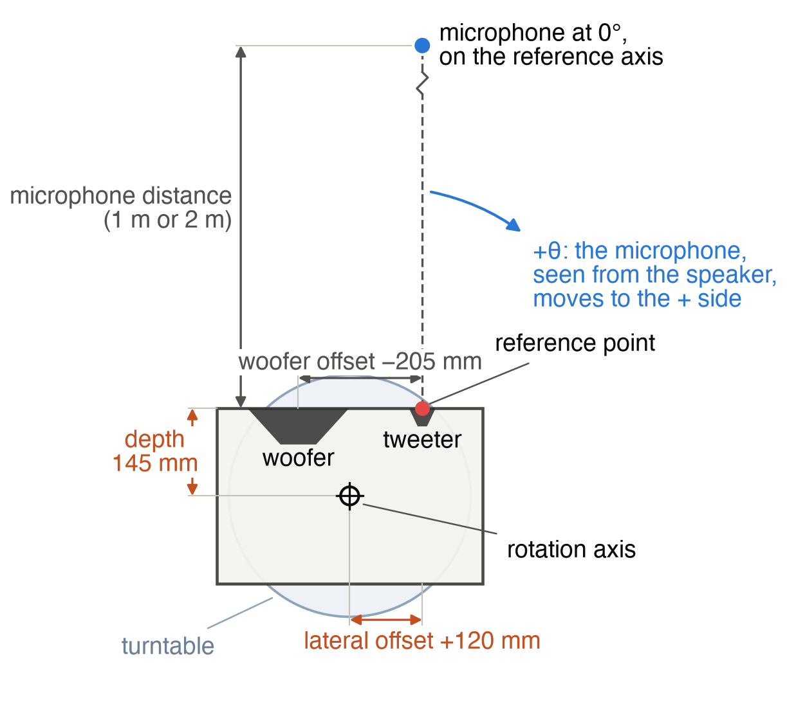
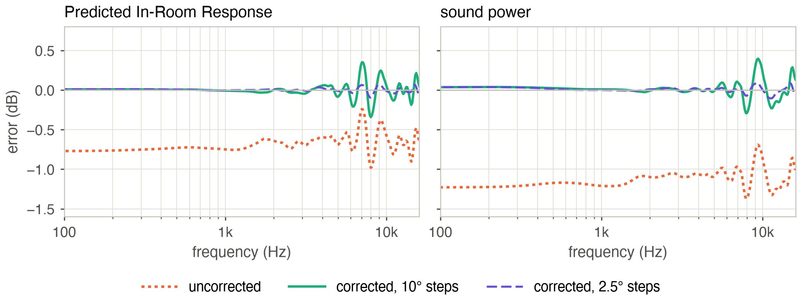

A loudspeaker's off-axis behavior is measured by turning it in front of a fixed microphone. For the
data to mean what they should, the loudspeaker has to turn about a point on its baffle, the reference
point, usually on the tweeter axis. The microphone then stays at the same distance from that point at
every angle, as a distant listener would. CTA-2034-A, the standard behind the "spinorama" curves, defines
its measurements that way, on a horizontal and a vertical orbit (a full circle of measurement positions)
around the reference point, at 2 m [3].

With a large turntable, or a rig that holds the cabinet with its baffle over the axis, this is easy. The
turntables most small manufacturers and hobbyists use are 30 to 40 cm across. A large loudspeaker, a
three-way tower for instance, cannot stand on such a table with its baffle over the axis, because most of
the cabinet would hang off the edge. So it goes in the middle of the table, and the rotation axis runs
through the middle of the box (Figure 1).

Everything in this article comes from simulations, computed with the boundary element method (BEM). A
simulation can measure the same loudspeaker both ways, with the axis on the baffle and with the cabinet
centered, and compare them exactly. It also leaves out what would blur that comparison in a real
measurement: the room and its reflections, the gating window, noise, positioning errors, and the drivers'
own behavior, such as cone breakup, since the diaphragms are rigid. What remains is the problem itself,
moving the measurements from where they were taken to where they should have been, and the cabinet's part
in it.

The loudspeaker studied is an ordinary two-way: a 24-liter closed box, 290 mm wide, 440 mm high and 290 mm
deep, with a Dayton Audio SIG225-4 8-inch woofer and a SICA LP 90.28/N92 1.1-inch dome tweeter 205 mm
above it. Their responses follow the manufacturers' datasheets, and a crossover sums them: each driver is
equalized on axis to a fourth-order Linkwitz-Riley target at 2 kHz. In the simulation the woofer is a rigid
recessed cone and the tweeter a rigid dome. A two-way of this size keeps the drawings and the computations
simple, and it would fit on a small turntable more easily than a large three-way tower. The geometry is the
same, though, and the errors to correct grow with the depth of the cabinet.

{width=100%}

## What Goes Wrong

Standing on the turntable for its horizontal directivity, the two-way turns about an axis 145 mm behind
the baffle, and the microphone faces the tweeter at 0°. For its vertical directivity it lies on its side
(Figures 1 and 2). The axis is still 145 mm behind the baffle, but the tweeter is now 120 mm to the side of
it, so the microphone has to be moved 120 mm sideways to face it at 0°.

{width=62%}

Off axis, the microphone is then farther from the drivers than intended. In the vertical orbit, behind the
cabinet, at a nominal 1 m, it is up to a third farther away, so the response reads 2.5 to 2.8 dB low, and
the sound arrives up to 1 ms late. Each driver is also heard from another direction than the nominal
angle, by as much as 15°. Since the microphone was moved sideways, the errors are not the same on the
woofer's side and on the other. At 2 m the level and direction errors are about halved, while the delay
stays the same, because it depends on where the axis is, whatever the distance.

Figure 3 shows what this does to the summed loudspeaker in the vertical orbit. At 60° above the axis, the
uncorrected response is 1 to 2 dB low. At 150°, it also has notches around the 2 kHz crossover that the
real response does not have. Heard from the wrong place, the woofer and the tweeter reach the microphone
with another relative delay, and they no longer add up the same way.

{width=100%}

## Putting the Measurements Back

The correction works one driver at a time, each measured on its own. For each nominal angle, it asks where
the microphone should
have been, and which measurements were taken closest to that direction, as seen from the driver. Both
questions have exact answers, because the geometry of the setup is known. The correction takes the two
measurements whose directions bracket the ideal one, moves each to the ideal distance, and averages them,
each with a weight that depends on how close its direction is to the ideal one.

Moving a measurement to another distance assumes that, around each driver, the sound behaves like that of
a point source with some directivity. Farther away, the sound arrives later and its pressure falls in
inverse proportion to the distance (6 dB per doubling), while its directivity stays the same. Each move is
then a delay and a gain. The directivity itself can be anything, since the measurements describe it.

All of this needs four distances in each plane of rotation, which a tape measure provides (Figure 2):

- the depth, from the rotation axis to the baffle;
- the lateral offset, from the rotation axis to the reference axis (the line the microphone is on at 0°),
  with its sign;
- each driver's offset from the reference axis;
- the microphone distance at 0°.

A driver out of the plane the microphone turns in also has its distances counted in 3D. Standing for its
horizontal orbit, the two-way has its woofer 205 mm below that plane; taking it as in the plane would cost
only a few hundredths of a dB here.

The two measurements can be averaged as complex responses, magnitude and phase together, or as powers,
the squared magnitudes, which ignore the phase. When the two measurements are in phase, both give almost
the same result. When they are not, the complex average partly cancels and digs notches that neither
measurement has. This happens behind the cabinet at high frequency, where the response changes faster
with angle than a 10° step can follow. Averaging the powers avoids it. The cost is small: on the steep
edge of a driver's main lobe, where the level changes quickly with angle, the power average reads slightly
high. The correction here averages the powers and keeps the phase of the complex average (see "The
Arithmetic" sidebar).

## The Simulation

The BEM computes the sound field around the cabinet from what happens on its surface, every face and edge
of the box included. It was solved from 20 Hz to 16 kHz in 1/48-octave steps, at 1,728 microphone
positions: the horizontal and vertical orbits of both setups, at 1, 2 and 4 m, every 2.5°. It took
3.8 hours on a Mac mini with the BEM solver I am developing.

To compare a corrected measurement with the reference, I take their level difference at every angle and
frequency, after 1/24-octave smoothing, and compute its RMS value. The points more than 20 dB below the
on-axis response are left out: in a deep null, a fraction of a degree changes the level by tens of dB.

## How Close It Gets

In the vertical orbit, at 1 m with 10° steps, the summed two-way is 2.56 dB RMS off before correction and
0.62 dB after. The corrected curves of Figure 3 follow the reference closely at 60° and 120°. At 150° they
match up to a few kHz and keep some error above. The horizontal orbit, where only the depth is offset,
goes from 1.86 to 0.38 dB RMS.

That remaining error comes from the cabinet. With the same drivers as point sources in an infinite baffle,
the correction leaves 0.09 dB RMS. A cabinet adds diffraction: when the sound running along the baffle
reaches an edge, the edge radiates a secondary wave, as if a weaker source sat there. The microphone hears
the sum of the direct sound and these edge waves, each with its own delay. The correction cannot move the
edge waves properly, because it moves everything as if it came from the driver. And behind the cabinet,
where the edge waves are most of what the microphone hears, their interference pattern changes faster with
angle than 10° steps can follow.

Figure 4 shows where the error sits in the vertical orbit: behind the cabinet, and below the axis, on the
woofer's side, where the bottom edge of the baffle, 340 mm below the tweeter, adds ripples with a period
of only 10° around 6 kHz.

{width=100%}

A finer angular step removes most of it (Table 1). With 10° steps the residual is about the same at every
distance, because the interference patterns keep their angular period. With 2.5° steps it falls to 0.14 dB
at 2 m and 0.09 dB at 4 m. At 1 m about 0.4 dB remains even with 2.5° steps, because that close to the
cabinet the correction gets the timing of the edge waves slightly wrong, which no step can fix.

| Summed two-way | 1 m | 2 m | 4 m |
|---|---|---|---|
| Uncorrected | 2.56 | 1.79 | 1.20 |
| Corrected, 10° steps | 0.62 | 0.60 | 0.58 |
| Corrected, 5° steps | 0.41 | 0.28 | 0.27 |
| Corrected, 2.5° steps | 0.38 | 0.14 | 0.09 |

Table 1: RMS level error of the summed two-way on the vertical orbit (dB), against the angular step.

Averaging powers matters most with coarse steps. With 10° steps, the complex average leaves 1.21 dB RMS
at 1 m, twice as much, with notches down to −20 dB behind the cabinet, where the orange curve of Figure 4
peaks. With 2.5° steps, neighboring measurements are in phase again and both averages agree.

## Drivers One by One, or the Whole Loudspeaker

So far each driver was measured on its own and moved from its own position, then the two were summed
through the crossover. A finished loudspeaker, a passive one for instance, is often measured as a whole,
and can then only be moved from one point, the reference point on the tweeter axis. Measured at once and
corrected that way, the two-way keeps 0.68 dB RMS of error on its vertical orbit at 1 m with 10° steps,
against 0.62 dB with the drivers taken one by one, and its PIR is the same. The difference sits around the
crossover, 0.85 against 0.70 dB between 1 and 4 kHz, because the woofer and the tweeter keep the relative
delay of the position the microphone was really at. That error should grow with the drivers' distance from
the reference point, relative to the measurement distance, as on a tall tower measured up close, which this
study did not simulate. Measuring the drivers separately remains the cleaner way, and it is the one a
crossover is designed from.

## The Spatial Averages

CTA-2034-A condenses the polar data into a few curves: the listening window (the average of the
directions within ±30° horizontally and ±10° vertically), the early reflections (the directions that
reach a listener after one reflection off the walls, floor and ceiling), the sound power (all directions),
and the Predicted In-Room Response, or PIR, a weighted blend of the three that predicts the response in a
typical room. All of them are power averages over many directions.

The centered setup lowers them all, because every off-axis position is too far away. Computed from both
orbits, the PIR is up to 1.0 dB low at 1 m. After correction with 10° steps it is within 0.35 dB of the
reference, and within 0.10 dB with 2.5° steps (Figure 5). Up to about 3 kHz the corrected PIR is within
0.05 dB at any step. Above, the deviations come in narrow bands, where the residual errors of individual
directions do not cancel in the average.

{width=100%}

Part of what remains with 10° steps belongs to the standard's own sampling. The reference listening window,
computed from directions 10° apart, already differs by up to 0.3 dB around 13 kHz from the same window
averaged every 2.5°. With 10° steps, a few tenths of a dB in narrow bands is the resolution of the
measurement, corrected or not.

## The Lateral Offset

An error of 10 mm on the depth or on the lateral offset, or of 20 mm on the microphone distance, changes
the PIR by less than 0.1 dB, so a tape measure is accurate enough.

Lying on its side, the two-way also needs its lateral offset: the tweeter is 120 mm from the rotation axis,
and the correction must know on which side. With the offset left at zero, as for a symmetric loudspeaker,
it places the measurements up to 11° away from where they were taken at 1 m, and up to 21° with the wrong
sign. The individual curves of the vertical orbit then keep 1.4 and 2.0 dB RMS of error, two to three
times the residual with the right offset.

With complex averaging, either mistake is worse than no correction at all. The two measurements around each
direction, moved with the wrong delays, no longer line up in time and cancel each other. Computed from both
orbits, the PIR ends up 1.7 to 1.8 dB off at 1 m, against 1.0 dB for the raw data. With the powers
averaged, it stays within 0.4 dB, as with the right offset, while the individual curves keep the errors
above.

To check the sign, turn the table to +90° and look at which side of the cabinet faces the microphone. The
lateral offset is positive if the reference axis lies on that side.

## Measuring at 1 m for Results at 2 m

Measuring at 1 m and rebuilding the data as seen from 2 m is tempting. At 1 m the room's reflections arrive
later relative to the direct sound, which leaves a longer usable window, and CTA-2034-A works at 2 m. The
same correction can do it, with the ideal positions on a 2 m circle. The drivers beside the reference
axis are then heard from the right angles. The woofer, 205 mm from the tweeter, is 11.6° off its own axis
at 0° from 1 m, and 5.9° from 2 m.

The correction cannot account for the cabinet's sound field changing shape between 1 and 2 m. At low
frequency, the cabinet's acoustic center, the point the low-frequency sound appears to come from, sits
about 130 mm in front of the baffle, as Vanderkooy showed [2]. From 1 to 2 m the level then falls by 6.6 dB
in front of the cabinet and 5.5 dB behind it, where the point-source model assumes 6 dB everywhere.

At high frequency, the diffraction pattern itself changes with distance. Rebuilt from 1 m, the 2 m data of
the vertical orbit keep 0.67 dB RMS of error on the summed loudspeaker, even with 2.5° steps, where
measurements taken at 2 m keep 0.14 dB. When the room allows it, measure at the distance you want the
results at.

## Limits

This is a free-field study. In a real room the measurements are gated to remove the reflections, and the
delays the correction applies, up to 1 ms behind the cabinet, move the sound relative to the gate. That
interaction is not simulated. The drivers are rigid, and the cabinet's edges are sharp. Rounded edges
diffract less, which should help the correction. Only one cabinet was tested, and a tower or a tweeter in a
waveguide will behave differently.

The full study also covers a three-way monitor in the same cabinet, with an analytical model of edge
diffraction instead of the BEM [1]. That model reaches the same conclusions below 3 kHz but underestimates
the diffraction above, mainly because a rigid dome radiates wider than it assumes, so more of its sound
reaches the edges.

The study's code and data, and a technical report with every formula, are on GitHub
(github.com/Arnwald/turntable-rotation-center-study).

---

> **Sidebar: The Arithmetic**
>
> A measurement taken at a distance $\rho$ from a driver is moved to the ideal distance $\rho'$ by a delay
> and a gain:
>
> $$\Delta t = \frac{\rho' - \rho}{c}, \qquad G = 20 \log_{10} \frac{\rho}{\rho'} \ \mathrm{dB}$$
>
> Two measurements $a$ and $b$, moved to the same distance, are averaged with a weight $u$ that goes from 0
> at the direction of $a$ to 1 at the direction of $b$. Their powers are averaged, and the phase is that of
> the complex average:
>
> $$|H|^2 = (1-u)\,|H_a|^2 + u\,|H_b|^2$$
>
> An example, for the two-way lying on its side at 1 m (Figure 2): the measurement at a nominal 90° was
> taken 1.059 m from the tweeter, which heard it at 104.5°. The tweeter's response at a true 90° is rebuilt
> from the measurements taken at nominal 70° and 80°, which the tweeter heard at 82.4° and 93.6°. The 80°
> one gets a weight of 0.68, the 70° one 0.32. Both are brought to 1 m: the 80° one is advanced by
> 0.089 ms and raised by 0.26 dB, the 70° one advanced by 0.017 ms and raised by 0.05 dB.

> **Sidebar: Checklist for a Small Turntable**
>
> 1. Center the cabinet on the turntable. Put the microphone on the reference axis at 0°, at the height of
>    the reference point.
> 2. Measure the depth and the lateral offset to within a centimeter. Give the lateral offset its sign:
>    positive if the reference axis lies on the side the microphone faces at +90°.
> 3. Give each driver its offset from the reference axis in the plane of rotation. A woofer beside the
>    tweeter, as in a two-way lying on its side, is not at zero.
> 4. Measure the drivers on their own when you can. A whole loudspeaker can be corrected as one source at
>    the reference point, a little less well around the crossover.
> 5. Average the powers between measured directions.
> 6. Use 5° steps or finer if the response above a few kHz matters, 2.5° to get closest.
> 7. Measure at the distance you want the results at, when the room allows it.
> 8. Treat rear responses at mid and high frequencies as approximate. Below 3 kHz, the spatial averages are
>    good to about 0.1 dB.

---

**References**

[1] M. Urban, C. Heil, C. Pignon, C. Combet and P. Bauman, "The Distributed Edge Dipole (DED) Model for
Cabinet Diffraction Effects," *Journal of the Audio Engineering Society*, Vol. 52, No. 10, 2004,
pp. 1043–1059.

[2] J. Vanderkooy, "The Low-Frequency Acoustic Center: Measurement, Theory, and Application," 128th
Convention of the Audio Engineering Society, London, 2010.

[3] ANSI/CTA-2034-A, *Standard Method of Measurement for In-Home Loudspeakers*, Consumer Technology
Association, 2015.

**About the Author**

Arnaud Demion is an engineer trained as a physicist, with a PhD from Aix-Marseille University. He runs DEM
Audio in Valais, Switzerland, where he designs loudspeakers and works as an acoustics and DSP consultant for
manufacturers (demaudio.com).
